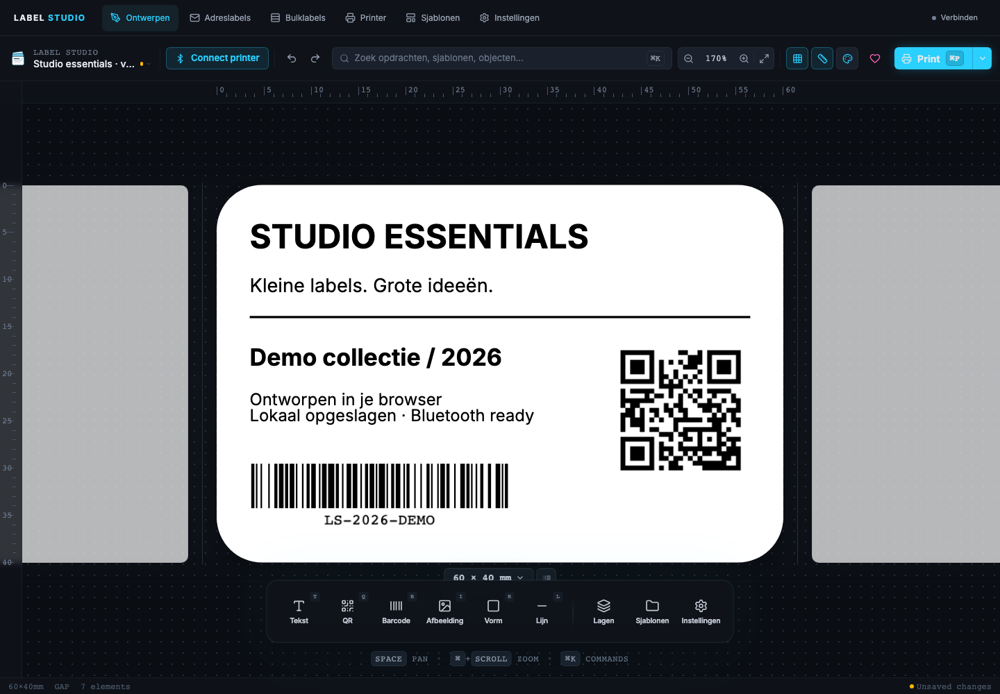
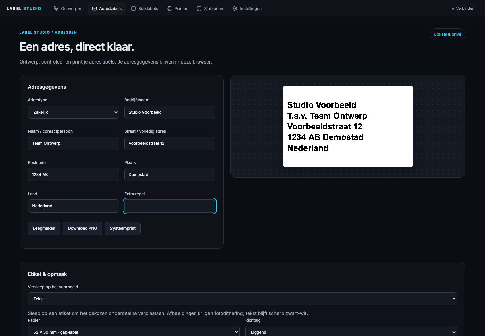
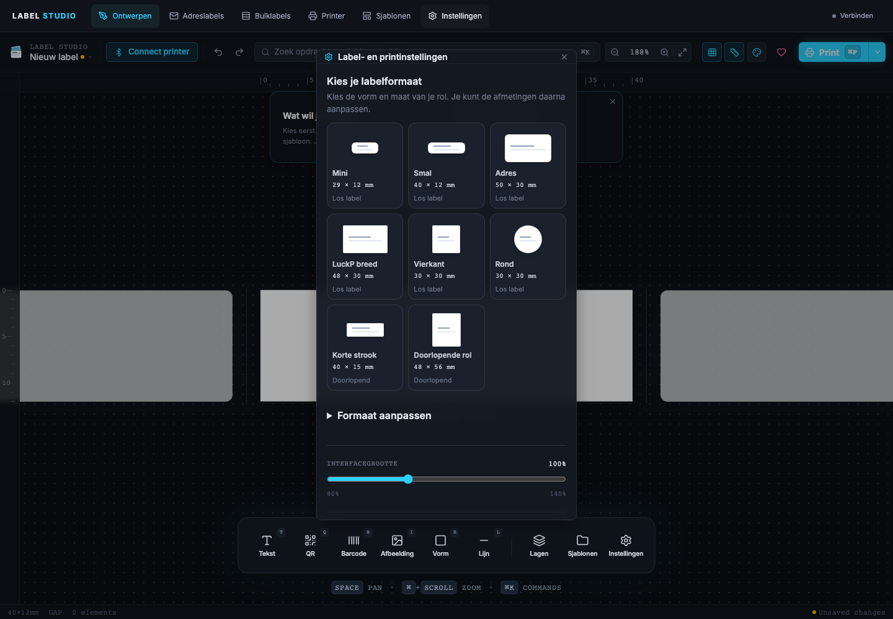
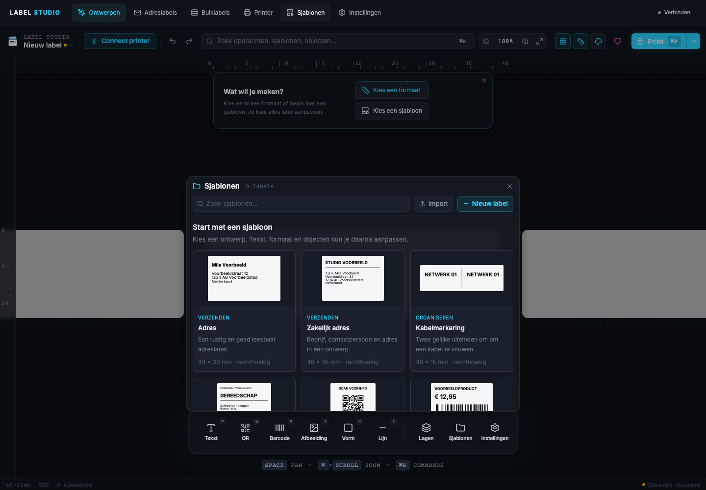
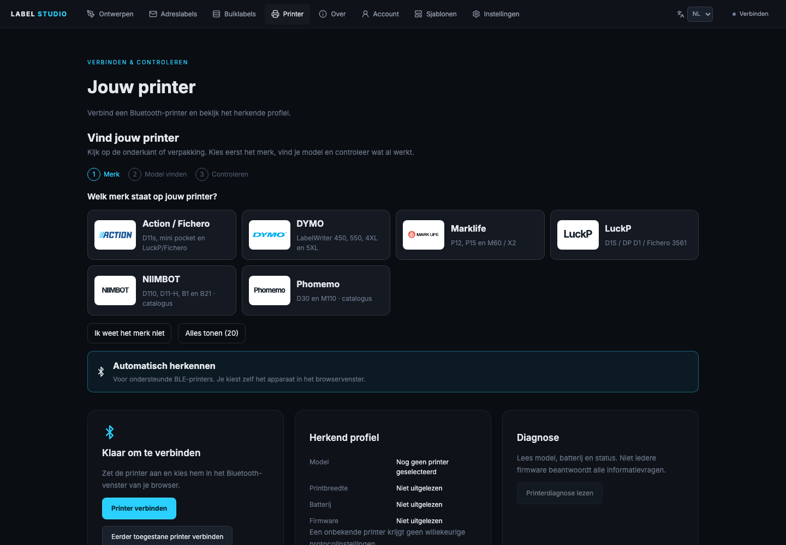
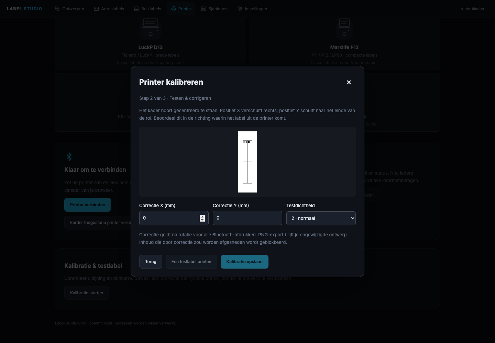

# Label Studio

[](https://github.com/remb0/label-studio/actions/workflows/ci.yml)


Een labelstudio in je browser: visueel ontwerpen, enkele adreslabels maken en CSV-bestanden via een grafische wizard in bulk afdrukken. Adressen en afbeeldingen worden lokaal verwerkt.

Productieadres: **[labels.remb0.nl](https://labels.remb0.nl)**, bereikbaar via de HTTPS-reverseproxy.





## Wat kun je ermee?

- Visuele editor op basis van Thermoprint: tekst, afbeeldingen, QR, barcodes, vormen, lagen, grid, linialen, zoom en undo/redo.
- Een aparte werkplek voor zakelijke en particuliere adreslabels, inclusief het BoxCare-logo of je eigen afbeelding.
- CSV-wizard met scheidingstekenherkenning, kolommapping, filters, bewerkbare validatie en labelvoorbeelden.
- Bulkqueue met proefdruk, pauze, annuleren en expliciete controle van onzekere afdrukken.
- Sjablonen en mappingprofielen lokaal bewaren en als JSON exporteren/importeren.
- Visuele formaatkaarten met later aanpasbare mm/px-maten, acht kant-en-klare startsjablonen en geïllustreerde printerkeuze met passende standaardinstellingen.
- Automatische lokale concepten, expliciet conceptherstel, favorieten en tekst die optioneel in het tekstvak past.
- Kalibratiewizard met testlabel, dichtheidskeuze en veilige uitlijncorrectie per fysieke printer.
- Web Bluetooth en directe printerondersteuning voor LuckP D1S en de 96-dot Fichero D11s met Bluetoothnaam `FICHERO_5836_BLE`, plus behouden Thermoprint-profielen.
- Uitgebreide labelinstellingen, vormmaskers, geprinte scheidingslijnen en lichte/donkere thema's. Een scheidingslijn verdeelt het ontwerp visueel; hij start geen afzonderlijke printjobs.
- Lokaal of in Docker draaien; geen database nodig.

## Snel lokaal starten

Gebruik Node.js 24 LTS of nieuwer (minimaal 22.12):

```sh
git clone https://github.com/remb0/label-studio.git
cd label-studio
npm ci
npm run dev
```

Open het lokale adres in Chrome of Edge. Op macOS kun je na `npm ci` ook `start.command` openen. Voor de oorspronkelijke adresapp zie [legacy/](legacy/).

## Docker

```sh
docker compose up -d --build
```

Standaard is de app alleen op `http://127.0.0.1:3022` bereikbaar. Gebruik voor de productiehost de LAN-bind en een vast commit-ID:

```sh
LABEL_STUDIO_BIND=192.168.0.13 COMMIT_SHA=<git-commit> docker compose up -d --build
```

Configureer Nginx Proxy Manager voor `labels.remb0.nl` → `http://192.168.0.13:3022`, met een geldig certificaat en HTTPS. Bluetooth werkt niet vanaf een gewoon HTTP-adres op het LAN. De container luistert op 8080 en draait zonder root, met een read-only filesystem en tijdelijke schrijfruimte in `/tmp`.

## Bluetooth en printerprofielen

Volg bij **Printer** de wizard: **merk → model vinden → controleren**. De start toont merklogo's in plaats van een volledige modellenlijst. Zoek op modelnaam of Bluetooth-alias en combineer filters voor merk, verbinding, resolutie, papier en labelmaat. Standaard verschijnen maximaal vier resultaten; **Alles tonen** breidt de lijst bewust uit. Onbekende verbindingstypen worden niet als BLE of Classic geraden.

De compacte kaarten tonen tekst naast het logo of de productfoto. Alleen exact bevestigde modelafbeeldingen worden gebruikt; anders verschijnt **Foto nog niet bevestigd**. Merklogo's en neutrale pictogrammen zijn geen modelafbeeldingen. Zie de [afbeeldingencontrole per model](docs/printer-images.md) voor bronnen en ontbrekende foto's.

De catalogus bevat **20 modellen en 14 modelafbeeldingen**, waaronder zes nieuwe catalogusprofielen van NIIMBOT en Phomemo. Open na je modelkeuze **Specificaties en bronnen** voor hardwaregegevens, bronlinks en onzekerheden. Resolutie, papierbreedte en printkopbreedte worden niet door elkaar gehaald; onbekende of tegenstrijdige gegevens blijven expliciet onbekend. Nieuwe catalogusprofielen ondersteunen alleen ontwerpen en PNG-export, geen nieuwe printroute. Zie de [profielcontrole en GitHub-referenties](docs/printer-profiles.md).

Een ontwerpprofiel vooraf kiezen is optioneel. Met **Printer zoeken** open je direct het Bluetoothvenster; je hoeft niet eerst een model te bevestigen. Na jouw apparaatkeuze herkent de app ondersteunde modellen aan de Bluetoothnaam, controleert de verbinding en laadt passende basisinstellingen of eerder opgeslagen apparaatinstellingen. Je bestaande ontwerp en labelmaat blijven behouden. Een herkend, verbonden apparaat wordt het nieuwe voorkeursprofiel, ook wanneer eerder een ander of design-only profiel gekozen was. Annuleren, onbekende modellen en mislukte verbindingen wijzigen de voorkeur niet. Catalogusvermelding betekent geen ondersteuning voor direct printen: onbekende apparaten krijgen nooit een willekeurig protocol.

De printerpagina, **Connect printer** in de editor, **Verbinden** in de navigatie en de Print-knop openen dezelfde verbindingsflow. **Printer zoeken** staat boven de optionele profielwizard en roept vanuit de klik direct de browserkiezer aan, met dezelfde apparaatfilters en servicetoestemmingen. Zoeken blijft tijdens een actieve printopdracht geblokkeerd. Een browserfout wordt getoond en kan opnieuw worden geprobeerd. Automatische tests controleren dit met een gesimuleerde Bluetooth-API; zij bewijzen geen fysieke printerverbinding.

### Bluetooth Classic en wifi

Web Bluetooth is de huidige BLE/GATT-route. Bluetooth Classic is technisch mogelijk via Web Serial/RFCOMM (SPP of een passende RFCOMM-service) in geschikte Chrome-versies: desktop vanaf Chrome 117 en Android vanaf Chrome 138. Dit vereist eerst OS-koppeling, browsertoestemming en een ondersteund printerprotocol. Label Studio implementeert deze transportlaag nog niet; detectie van `navigator.serial` alleen bewijst geen printercompatibiliteit. Zie [Chrome Classic-documentatie](https://developer.chrome.com/blog/serial-over-bluetooth) en [Android-ondersteuning](https://developer.chrome.com/release-notes/138#web_serial_over_bluetooth_on_android).

Wifi/LAN kan vanuit een browser met een geschikte HTTP(S)- of WebSocket-printer-API. CORS, CSP, beveiligde context, browser-/lokale-netwerktoestemming en het printerprotocol moeten allemaal kloppen. Een gewone website kan niet rechtstreeks een raw-TCP-printerpoort zoals 9100 openen. Voor zulke printers is een lokale, geauthenticeerde printbridge een passende vervolgstap; die is nu niet gebouwd of geactiveerd. [Local Network Access](https://developer.chrome.com/blog/local-network-access) en [raw sockets versus geïnstalleerde Isolated Web Apps](https://developer.chrome.com/docs/iwa/direct-sockets) beschrijven de browsergrenzen. ESPHome blijft een aparte TODO voor later.

Klik op **Verbinden** en selecteer de printer in de browserkiezer. De Bluetooth-adapter van je laptop of telefoon maakt verbinding; de Dockerhost heeft daarvoor geen Bluetooth nodig.

| Printerfamilie                             | Printkop                                                 | Status                                                                                                   |
| ------------------------------------------ | -------------------------------------------------------- | -------------------------------------------------------------------------------------------------------- |
| Fichero D11s / `FICHERO_5836_BLE`          | 96 dots, 203 dpi, 12 mm printbaar op 14 × 30 mm labels   | AiYin-protocol uit hardwaregeverifieerde bron geïmplementeerd; fysieke validatie in Label Studio vereist |
| LuckP D1S / DP D1 / Fichero 3561           | 384 dots, 203 dpi, circa 48 mm printbaar op 52 mm papier | Lujiang-protocol overgenomen en automatisch getest; fysieke validatie vereist                            |
| Marklife/Pristar-profielen uit Thermoprint | Profielafhankelijk                                       | Upstreamondersteuning behouden; niet op eigen hardware geverifieerd                                      |

De app bewaart printervoorkeuren per eerder toegestaan browserapparaat. De browser blijft beslissen over toestemming en opnieuw verbinden. Onbekende modellen worden niet met een willekeurig profiel aangestuurd.

Bij LuckP betekent een afgeronde opdracht **verzonden**. Controleer de fysieke afdruk: de printer geeft geen betrouwbare bevestiging voor ieder geprint label. Na verbindingsverlies wordt de laatste rij als onzeker behandeld; hervatten drukt die niet automatisch opnieuw af.

Safari en Firefox kunnen de editor gebruiken maar bieden geen normale Web Bluetooth-printroute. Gebruik Chrome of Edge op een apparaat met beschikbare Web Bluetooth-ondersteuning. HTTPS of localhost is verplicht.

## CSV-import

1. Kies **Bulklabels** en laad een CSV-bestand.
2. Controleer scheidingsteken en kopregel.
3. Koppel bronkolommen aan bedrijfsnaam, naam, straat, huisnummer, postcode en plaats. Bekijk direct voorbeeldwaarden.
4. Stel filters en standaardwaarden in; de BoxCare-export wordt automatisch voorgesteld.
5. Corrigeer ontbrekende adresgegevens en controleer de gegenereerde labels.
6. Print eerst een proeflabel en start daarna de geselecteerde batch.

Het CSV-bestand en de adressen worden niet naar de server gestuurd. Mappingprofielen bevatten de koppelingen en filters, niet de adresrijen. Exporteer zo'n profiel om het op een ander apparaat te gebruiken.

## Beginnen met een formaat of sjabloon

Een leeg ontwerp biedt **Kies een formaat** en **Kies een sjabloon**. De formaatkaarten tonen de echte verhoudingen: mini, smal, adres, LuckP breed, vierkant, rond en twee doorlopende stroken. Pas de exacte maat later aan via **Formaat aanpassen**. Dezelfde kaarten staan onder het label op het canvas. Bestaande objecten blijven behouden bij een andere maat; controleer na verkleinen of alles nog binnen het label valt.

De sjablonengalerij bevat acht bewerkbare voorbeelden: **Adres**, **Zakelijk adres**, **Kabelmarkering**, **Opbergdoos**, **QR-link**, **Product & prijs**, **Breekbaar** en **Rond datumlabel**. Elk voorbeeld opent als een nieuw ontwerp. Je eigen opgeslagen sjablonen blijven behouden. Bij niet-opgeslagen wijzigingen vraagt de app eerst of je deze wilt vervangen.







## Concepten, passende tekst en favorieten

Wijzigingen aan een ontwerp worden na ongeveer 600 ms lokaal als concept bewaard, ook bij formaatwijzigingen en undo/redo. Na herladen kies je **Concept herstellen** of **Concept verwijderen**. Herstellen opent een niet-opgeslagen kopie; een opgeslagen sjabloon wordt niet overschreven. Handmatig opslaan, openen of een nieuw ontwerp beginnen ruimt het oude herstelconcept op. Bluetooth-verbindingen en printopdrachten worden nooit hersteld. Navigeren tussen menu's bewaart de huidige sessie zonder herstelvraag.

Een concept is één herstelplek voor de ontwerper, geen archief of synchronisatie. CSV-bestanden en de adreswerkplek vallen hier niet onder. Bij volle/geblokkeerde browseropslag verschijnt een waarschuwing: exporteer belangrijke ontwerpen als JSON. Op gedeelde computers kunnen concepten persoonlijke gegevens bevatten.

Selecteer een tekstobject en schakel **Tekst automatisch passend maken** in. De ingestelde lettergrootte is het maximum; de tekst wordt zo nodig kleiner binnen breedte en hoogte van het tekstvak. Vergroot het vak wanneer de tekst onleesbaar klein wordt. De canvasweergave, PNG en Bluetooth-afdruk gebruiken dezelfde tekstlayout. Bij onmogelijke tekstpassing of objecten buiten de labelrand verschijnt een selecteerbare waarschuwing; de editor blokkeert printen totdat je dit corrigeert. De controle van ronde en afgeronde labels is conservatief en kijkt naar de objectkaders, niet alleen de zichtbare pixels.

Klik op de **ster** bij een formaat, startsjabloon of eigen sjabloon om het als favoriet te markeren. Favorieten verschijnen bovenaan binnen hun eigen groep en worden lokaal onthouden. Een ster aanklikken opent geen ontwerp en verandert het actieve formaat niet.

## Printer kalibreren

1. Verbind de juiste printer en controleer het papiertype bij de printerinstellingen.
2. Ga naar **Printer → Kalibratie starten**. Controleer de breedte dwars over de printkop en de lengte langs de rol; dit wijzigt het ontwerp niet.
3. Print bewust één testlabel. Bekijk centrering van het kader en de licht-/donkerblokken. Pas X/Y-correctie (−5 tot +5 mm) en testdichtheid aan en print eventueel opnieuw.
4. Kies **Kalibratie opslaan**. De correctie geldt uitsluitend voor dit browserapparaat en printermodel. Zet X/Y weer op nul en sla op om de correctie te verwijderen.

Positief X schuift rechts, positief Y naar het einde van de rol, gezien in de uitvoerrichting. Uitlijncorrectie wordt na rotatie en resolutieconversie toegepast op alle Bluetooth-afdrukken, ook enkele adreslabels en bulklabels. Een correctie die inhoud afsnijdt wordt geweigerd; geef het ontwerp voldoende marge. PNG-export blijft ongewijzigd. Dichtheid wordt de nieuwe editorbasis; adreslabels houden hun eigen expliciete dichtheidskeuze. De wizard print nooit automatisch en hervat geen mislukte testprint. Controleer hardware altijd fysiek; verzonden is geen afdrukbevestiging.



## Ontwikkelen en testen

```sh
npm run lint
npm run typecheck
npm test
npm run build
npx playwright install chromium
npm run test:e2e
```

De tests controleren onder andere CSV-parsing, mapping, adresvalidatie, labelgeometrie, imports, protocolbytes, servicefallback, chunking en verbindingsverlies. Browsertests controleren de editor, navigatie, mobiele viewport en CSV-flow. Mocktests bewijzen geen fysieke afdrukkwaliteit; gebruik de [hardwarechecklist](docs/hardware-validation.md).

## Releases en deployment

Een pull request draait lint, typecheck, tests, browserflows en een Docker-smoketest. De [releaseworkflow](.github/workflows/release.yml) publiceert na succesvolle CI op `main` een image met commit-tag naar GHCR. Automatisch bijwerken van de interne Dockerhost vereist een geconfigureerde deployment-runner; zie [deployment](docs/deployment.md). De app en `/version.json` tonen de gebouwde commit zodat een deployment controleerbaar is.

## Privacy

Geen analytics, externe fonts of adresuploads. Fonts en scripts worden in de build gebundeld. Templates, concepten, favorieten, kalibratie en printervoorkeuren worden lokaal in browseropslag bewaard. Let op: templates en concepten kunnen zelf persoonlijke tekst of afbeeldingen bevatten. Wis of exporteer deze bewust op gedeelde computers.

## Roadmap

- Hardwarevalidatie met `LuckP_D1S_F828_BLE` voor gap en continuous.
- Aanvullende printerprofielen na fysieke validatie.
- Volledige Nederlandse vertaling van alle overgenomen editorpanelen.
- Optionele IndexedDB-opslag voor grotere bibliotheken en afbeeldingen.
- **TODO voor later:** ESPHome Bluetooth Proxy via een lokale print-gateway onderzoeken. Er is nu geen ESPHome-instelling of gateway geïmplementeerd.

## Credits en licentie

MIT, © 2026 Remco van Geel. De editor en delen van de printerkern zijn gebaseerd op [tomLadder/thermoprint](https://github.com/tomLadder/thermoprint), upstreamcommit `51967b7bdf6ddfe6e64db6456fad86bf39276e9a`, dat MIT als licentie vermeldt. Het bestaande LuckPrinter-protocol is geïnspireerd op [0xMH/fichero-printer](https://github.com/0xMH/fichero-printer) en [thermal-pocket-printer-basic](https://github.com/ChiaraCannolee/thermal-pocket-printer-basic).

Zie [LICENSE](LICENSE) en [THIRD_PARTY_NOTICES.md](THIRD_PARTY_NOTICES.md).
