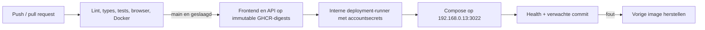

# Deployment

## Doel

- GitHub: private repository `remb0/label-studio`.
- Dockerhost: `192.168.0.13`.
- Services: `label-studio` (Nginx/frontend), `label-studio-api` en een intern bereikbare MySQL 8.4-database. Alleen Nginx publiceert hostpoort **3022**.
- Nginx Proxy Manager: domein `labels.remb0.nl`, scheme `http`, forward IP `192.168.0.13`, forward port `3022`.
- Nginx Proxy Manager verzorgt het HTTPS-certificaat en Force SSL. `/api` loopt via dezelfde origin naar de interne account-API.

Op 21 oktober 2026 was poort 3022 vrij en was de proxy-entry nog niet ingericht. De eigenaar stelt deze entry in. Direct LAN-HTTP is geschikt voor een healthcheck; Web Bluetooth vereist HTTPS of localhost.

## CI en release



De self-hosted runner is alleen bestemd voor vertrouwde deploymentjobs vanaf `main`. Tests en builds draaien op GitHub-hosted Ubuntu. Een pull request draait nooit op de deployment-runner. De runner maakt zelf een uitgaande verbinding naar GitHub; er wordt geen inkomende SSH-poort geopend.

De service draait als Linux-gebruiker `label-studio-runner`, lid van de Docker-groep. Docker-toegang geeft veel bevoegdheden op de host: beperk repositoryschrijfrechten tot vertrouwde gebruikers. Er is geen langlevend GitHub-token in de applicatie. De releasejob gebruikt zijn tijdelijke `GITHUB_TOKEN` om de private image te pullen; de Docker-login wordt in een tijdelijke map bewaard en na de job verwijderd.

De officiële runner wordt eenmalig via `scripts/bootstrap-runner.sh` geplaatst in `/opt/actions-runner-label-studio`; de eerste download wordt met SHA-256 gecontroleerd. Daarna gebruikt de runner de officiële automatische GitHub-updates. Controleer bij onderhoud of de service online is en bij de actuele runner-versie blijft.

Configureer vóór de eerste accountrelease de Actions-secrets `LABEL_STUDIO_MYSQL_PASSWORD` (minimaal 20 willekeurige tekens), `LABEL_STUDIO_SMTP_HOST`, `LABEL_STUDIO_SMTP_PORT`, `LABEL_STUDIO_SMTP_SECURE`, `LABEL_STUDIO_SMTP_USER`, `LABEL_STUDIO_SMTP_PASSWORD` en `LABEL_STUDIO_SMTP_FROM`. De database publiceert geen hostpoort. Maak en test periodieke back-ups van het volume `label-studio-mysql`; een applicatierollback draait een databaseschema niet automatisch terug.

## Verificatie

```sh
curl -fsS http://192.168.0.13:3022/health
curl -fsS http://192.168.0.13:3022/version.json
test "$(curl -s -o /dev/null -w '%{http_code}' http://192.168.0.13:3022/api/auth/session)" = 401
cat /docker/label-studio/.deployed-commit
docker inspect label-studio --format '{{.State.Health.Status}}'
docker inspect label-studio-api --format '{{.State.Health.Status}}'
docker inspect label-studio-mysql --format '{{.State.Health.Status}}'
```

Een geslaagde release bewijst containerwerking en de gedeployde commit. Voor Bluetooth, labeldoorvoer en afdrukkwaliteit is de [hardwarevalidatie](hardware-validation.md) vereist.

## Handmatig herstellen

Gebruik de vorige bekende image-digest uit de releasehistorie, niet een veranderlijke `latest`-tag:

```sh
LABEL_STUDIO_IMAGE=ghcr.io/remb0/label-studio@sha256:<vorige-digest> \
LABEL_STUDIO_API_IMAGE=ghcr.io/remb0/label-studio-api@sha256:<vorige-digest> \
MYSQL_PASSWORD='<bestaand-wachtwoord>' \
EXPECTED_COMMIT=<vorige-commit> bash scripts/deploy-image.sh
```

Bij een mislukte health- of commitcheck herstelt het script de vorige frontend- en API-images. MySQL-data en reeds toegepaste additieve schemawijzigingen blijven behouden; herstel daarom nooit uitsluitend op een applicatierollback.
