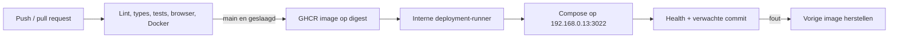

# Deployment

## Doel

- GitHub: private repository `remb0/label-studio`.
- Dockerhost: `192.168.0.13`.
- Service: `label-studio`, intern 8080, hostpoort **3022**.
- Nginx Proxy Manager: domein `labels.remb0.nl`, scheme `http`, forward IP `192.168.0.13`, forward port `3022`.
- Nginx verzorgt het HTTPS-certificaat en Force SSL. WebSocket-forwarding is niet nodig voor de statische productieapp.

Op 21 oktober 2026 was poort 3022 vrij en was de proxy-entry nog niet ingericht. De eigenaar stelt deze entry in. Direct LAN-HTTP is geschikt voor een healthcheck; Web Bluetooth vereist HTTPS of localhost.

## CI en release



De self-hosted runner is alleen bestemd voor vertrouwde deploymentjobs vanaf `main`. Tests en builds draaien op GitHub-hosted Ubuntu. Een pull request draait nooit op de deployment-runner. De runner maakt zelf een uitgaande verbinding naar GitHub; er wordt geen inkomende SSH-poort geopend.

De service draait als Linux-gebruiker `label-studio-runner`, lid van de Docker-groep. Docker-toegang geeft veel bevoegdheden op de host: beperk repositoryschrijfrechten tot vertrouwde gebruikers. Er is geen langlevend GitHub-token in de applicatie. De releasejob gebruikt zijn tijdelijke `GITHUB_TOKEN` om de private image te pullen; de Docker-login wordt in een tijdelijke map bewaard en na de job verwijderd.

De officiële runner wordt eenmalig via `scripts/bootstrap-runner.sh` geplaatst in `/opt/actions-runner-label-studio`; de eerste download wordt met SHA-256 gecontroleerd. Daarna gebruikt de runner de officiële automatische GitHub-updates. Controleer bij onderhoud of de service online is en bij de actuele runner-versie blijft.

## Verificatie

```sh
curl -fsS http://192.168.0.13:3022/health
curl -fsS http://192.168.0.13:3022/version.json
cat /docker/label-studio/.deployed-commit
docker inspect label-studio --format '{{.State.Health.Status}}'
```

Een geslaagde release bewijst containerwerking en de gedeployde commit. Voor Bluetooth, labeldoorvoer en afdrukkwaliteit is de [hardwarevalidatie](hardware-validation.md) vereist.

## Handmatig herstellen

Gebruik de vorige bekende image-digest uit de releasehistorie, niet een veranderlijke `latest`-tag:

```sh
LABEL_STUDIO_IMAGE=ghcr.io/remb0/label-studio@sha256:<vorige-digest> \
EXPECTED_COMMIT=<vorige-commit> bash scripts/deploy-image.sh
```

De deployment raakt uitsluitend de Compose-service `label-studio` aan. Bij een mislukte health- of commitcheck herstelt het script de vorige image; bij de allereerste deployment stopt het de mislukte service.
