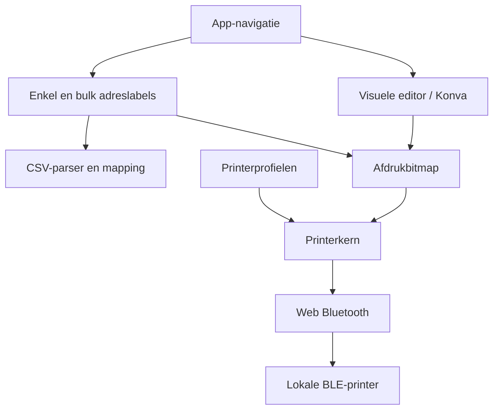

# Uitvoeringsplan Label Studio

Vastgestelde scope op 21 oktober 2026: eigen repository `remb0/label-studio`, lokale of Dockerinstallatie, productie `https://labels.remb0.nl`, direct Web Bluetooth, LuckP D1S met 384 afdrukpunten. ESPHome blijft een TODO voor later.

## Uitgangspunten

De bestaande adresapp is bewaard in `legacy/`. De nieuwe editor is gebaseerd op de MIT-gelicentieerde Thermoprint-broncode, met eigen modules voor adressen, CSV en het bestaande LuckP-protocol. Het 96-dot Fichero D11s-profiel is niet gelijk aan deze printer en wordt niet automatisch gekozen.

## Fasen

| Fase | Resultaat | Acceptatie |
| --- | --- | --- |
| 0. Basis | Repository, legacybaseline, bronvermelding | Geen oorspronkelijke bestanden verloren |
| 1. Fundament | React/TypeScript/Vite, Docker, tests | Lokaal en container starten |
| 2. Editor | Objecten, lagen, zoom, undo/redo, sjablonen | Browserflow save/new/open en schone PNG |
| 3. Printer | LuckP-profiel, detectie, opslag, diagnose | Exacte legacyprotocolbytes; fysieke proefdruk nog vereist |
| 4. Adressen | Enkel adres, logo, opmaak en preview | Voorbeeld en afdruk gebruiken dezelfde renderer |
| 5. CSV | Wizard bestand → mapping → filters → controle → ontwerp → afdrukken | BoxCare plus afwijkende kolommen werken; gewijzigde mapping maakt oude data ongeldig |
| 6. Release | GitHub CI, GHCR, interne deployment-runner | Main-tests geslaagd, immutable image, health+commit gecontroleerd |
| 7. Hardwareacceptatie | Gap, continuous, foto, QR/barcode en batch | Checklist met echte LuckP-printer doorlopen |

## Componenten

Editorstate, sjablonen, mappingprofielen en printervoorkeuren worden lokaal bewaard. Adresrijen blijven uitsluitend in het geheugen van de actieve browserpagina. De eerste implementatie gebruikt browser-localStorage voor kleine profielen/sjablonen; IndexedDB blijft een uitbreiding voor grotere bibliotheken. Alle fonts en runtime-assets worden lokaal gebundeld.

## Afbakening van de eerste implementatie

- Labelvormen zijn preview-/rastermaskers; ze veranderen de fysieke papiervorm niet.
- Labelsplitsing tekent een scheidingslijn; fysieke opsplitsing in meerdere printjobs is een latere uitbreiding.
- 300 dpi is een documentinstelling; de uitvoer wordt naar de werkelijke printer-dpi gerenderd.
- LuckP-printresultaat is "verzonden"; fysieke afdrukbevestiging blijft expliciet.
- Batches reserveren de printer ook tijdens een pauze. Onzekere rijen worden niet automatisch opnieuw verstuurd.
- De oorspronkelijke editor heeft nog enkele Engelse bedieningsteksten.
- Browser- en protocoltests zijn geen bewijs van afdrukkwaliteit op echte hardware.

## Volgende uitbreidingen

1. Hardwareacceptatie met `LuckP_D1S_F828_BLE` en vastleggen van optimale papierinstellingen.
2. Aanvullende presets en printerprofielen na fysieke tests.
3. Grotere bibliotheek in IndexedDB, met opslagquota en migraties.
4. Optioneel adresontwerp omzetten naar een vrij bewerkbaar generiek sjabloon.
5. **TODO later:** lokale gateway voor ESPHome Bluetooth Proxy onderzoeken, inclusief throughput, acknowledgements en herstel.
